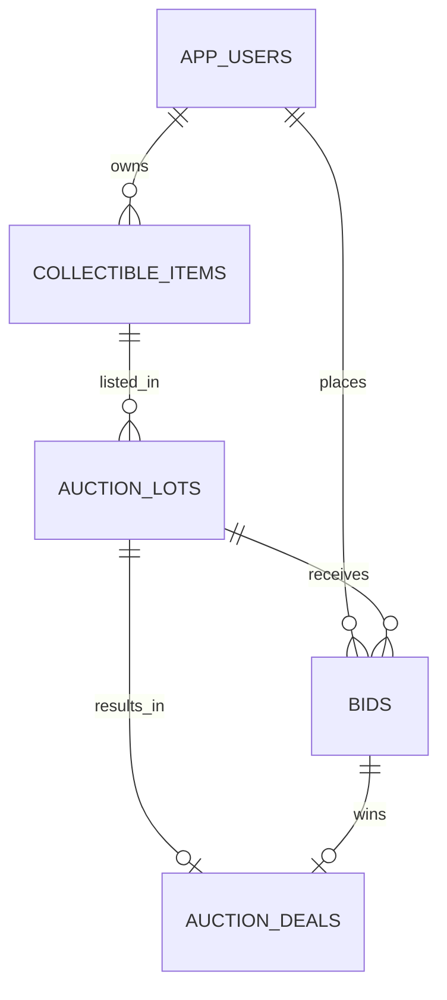

# Задание 3. Вариант 18 — Аукцион коллекционных предметов

Продолжение проекта из задания 2. Сервис позволяет хранить коллекционные предметы, выставлять их на аукцион, принимать ставки, определять победителя и передавать ему предмет. Java 21, Spring Boot 3.4.4, Maven, PostgreSQL 16, Spring JDBC. Все рабочие данные находятся в PostgreSQL и сохраняются при перезапуске.

## Быстрый запуск на Windows

1. Распакуйте архив. Установите Docker Desktop и запустите его (режим Linux containers).
2. Откройте PowerShell в папке проекта и выполните:

```powershell
powershell -ExecutionPolicy Bypass -File .\start.ps1
```

Скрипт создаст локальный `.env` с двумя разными случайными паролями и запустит БД и приложение. Первый запуск загружает образы и Java-зависимости и может занять несколько минут. Отдельно устанавливать Java, Maven и PostgreSQL при этом не требуется.

3. Проверьте в браузере: http://localhost:8080/api/users — должен появиться JSON с тремя тестовыми пользователями.
4. Импортируйте `postman/Auction.postman_collection.json` в Postman. Выберите коллекцию → Run → все 53 запроса по порядку, 1 iteration. `baseUrl` уже задан. Таймаут выполнения скриптов поставьте не меньше 60000 мс. Запрос закрытия сам ждёт конца 20-секундного аукциона. Весь прогон обычно занимает около 20–30 секунд.

При ручном исполнении запросов вместо Runner можно не успеть сделать ставки до окончания демонстрационного аукциона. В этом случае запустите всю коллекцию заново через Runner.

Остановка: `docker compose down`. Повторный запуск: `docker compose up -d`. Данные сохраняются в томе `auction_data`. Диагностика: `docker compose logs app` и `docker compose logs db`. Порты 8080 и 5432 должны быть свободны. Публикация портов ограничена локальным компьютером.

SQL-инициализация и демоданные выполняются только при первом создании тома. При изменении паролей в `.env` у уже созданной БД пароль роли автоматически не меняется: используйте исходный `.env` либо измените пароль роли через администратора.

## Запуск из IntelliJ IDEA

Требуются JDK 21 и Maven. Откройте `pom.xml` как Maven-проект. Сначала запустите БД командой `docker compose up -d db` (перед этим создайте `.env` по `.env.example` и задайте разные пароли). Затем запускайте `AuctionApplication`. Рабочая папка — корень проекта: оттуда читается `.env`. Встроенный сервер приложения из Compose одновременно запускать не нужно — он занимает тот же порт.

```powershell
mvn test
mvn spring-boot:run
```

Пароли не записаны в исходный код. `.env` исключён из Git и Docker build context. `.env.example` содержит только шаблон. `DB_URL`, `DB_USER`, `DB_PASSWORD`, `PORT` можно переопределить переменными окружения.

## Предметная модель и связи

| Сущность | Что хранит | Связи |
|---|---|---|
| Пользователь (`app_users`) | Имя, уникальный email | Владеет предметами, делает ставки |
| Предмет (`collectible_items`) | Описание, состояние, текущий владелец | Владелец → пользователь; история лотов |
| Лот (`auction_lots`) | Предмет, начальная цена, шаг, время и статус | Один предмет → много лотов в истории |
| Ставка (`bids`) | Лот, участник, сумма, серверное время | Пользователь и лот → много ставок |
| Сделка (`auction_deals`) | Лот, победившая ставка, сумма, статус передачи | Не более одной сделки на лот |



Статусы лота: `DRAFT → OPEN → CLOSED → SETTLED`; без ставок `OPEN → UNSOLD`; черновик или открытый лот без ставок можно перевести в `CANCELLED`. Статусы сделки: `PENDING → COMPLETED`.

В БД настроены первичные и внешние ключи, NOT NULL, UNIQUE, CHECK. Цены и суммы — NUMERIC(14,2), строго положительные. Конец аукциона позже начала. Статусы и состояния предмета ограничены перечнями. Email нормализуется к нижнему регистру и уникален. Частичный уникальный индекс запрещает одновременно резервировать предмет несколькими открытыми лотами или незавершёнными сделками. Составной внешний ключ сделки гарантирует, что победившая ставка относится к этому лоту и имеет ту же сумму. Удаление связанных записей ограничено RESTRICT.

Служебная таблица `auction_mutex` содержит одну строку для блокировки, не является сущностью предметной области и не имеет публичного API.

## Пять бизнес-операций

| Операция | Адрес POST | Условия и результат |
|---|---|---|
| Публикация | `/api/auction-lots/{id}/publish` | Только DRAFT с ещё не истёкшим сроком; предмет не занят другим OPEN/CLOSED лотом. Лот становится OPEN. До startTime он доступен для просмотра, ставки ещё запрещены. |
| Ставка | `/api/auction-lots/{id}/place-bid` | JSON `{"userId":2,"amount":1100}`. Только OPEN и startTime ≤ сейчас < endTime. Владелец не участвует. Первая ставка ≥ начальной цены, следующая ≥ максимальной + шаг. Время выставляет сервер. |
| Закрытие | `/api/auction-lots/{id}/close` | Только OPEN после endTime. Сервер выбирает максимальную ставку и атомарно создаёт PENDING-сделку и CLOSED-лот. Без ставок создаётся UNSOLD-лот, сделки нет. |
| Отмена | `/api/auction-lots/{id}/cancel` | Только DRAFT/OPEN и без ставок. Лот становится CANCELLED, предмет освобождается. |
| Завершение сделки | `/api/auction-deals/{id}/complete` | Только PENDING и CLOSED. Предмет атомарно переходит победителю, сделка — в COMPLETED, лот — в SETTLED. Повтор запрещён. Это фиксация завершения передачи в учебной модели; внешняя платёжная система не подключена. |

Ставка использует лот, предмет, пользователя и историю ставок. Закрытие использует лот, ставки и сделку. Завершение изменяет сделку, лот и предмет. Результаты зависят от состояния связанных объектов; эти операции не сводятся к обычному CRUD.

Все изменения выполняются в транзакциях. До чтения состояния захватывается одна строка `SELECT ... FOR UPDATE`. Поэтому проверка и запись согласованы даже при нескольких экземплярах приложения. При исключении откатывается вся операция. Решение намеренно последовательно обрабатывает изменения: для учебного объёма это простой и надёжный вариант; чтение не блокируется такой общей блокировкой. Все бизнес-изменения должны проходить через приложение.

## REST API и ограничения CRUD

Сохранены ресурсы задания 2: `/api/users`, `/api/collectible-items`, `/api/auction-lots`, `/api/bids`, `/api/auction-deals`.

Для каждого предусмотрены `GET` списка, `GET /{id}`, `POST`, `PATCH /{id}`, `PUT /{id}`, `DELETE /{id}`. PUT требует полное тело, PATCH принимает только изменяемые поля. `id` задаётся БД; неизвестные поля отклоняются.

- Пользователей можно создавать и изменять; удаление допускается только без ссылок из предметов и ставок.
- Предметы создаются с владельцем; описание и состояние изменяются, пока предмет не зарезервирован. Владельца можно менять только через завершение сделки. Предмет с историей лотов удалить нельзя.
- Лоты создаются в DRAFT. Только черновики можно редактировать и удалять. Статусы меняют бизнес-операции.
- `POST /api/bids` сохранён как совместимый вызов бизнес-операции ставки; `time` не принимается от клиента.
- `POST /api/auction-deals` закрывает истёкший OPEN-лот и формирует сделку. Если переданы `winningBidId`, `amount`, `transferStatus`, они должны совпадать с вычисленным победителем, суммой и PENDING. При несовпадении закрытие тоже откатывается.
- PATCH/PUT/DELETE ставок и сделок возвращают 409: история аукциона неизменяема. Завершение сделки доступно отдельной операцией. Коллекция содержит эти CRUD-запросы и проверяет ожидаемые отказы. Неограниченный CRUD истории позволил бы подменить победителя или стереть результаты торгов.

Создание: 201 и Location. Чтение/изменение/операция: 200. Удаление: 204. Некорректный JSON или поля: 400. Отсутствующая сущность: 404. Недопустимое состояние, дубликат email или нарушение FK: 409. Ошибка возвращает JSON с `status` и `message`.

Состояния предмета: POOR, FAIR, GOOD, EXCELLENT, MINT. Время — ISO-8601 с часовым поясом, например `2030-01-01T12:00:00Z`. Денежные значения — положительные, до двух знаков после точки. Конкретные ID берите из ответов: последовательности отдельные для каждой таблицы.

## Пользователь БД и тестовые данные

Инициализатор `db/00-init.sh` создаёт роль `auction_app`: без SUPERUSER, CREATEDB и CREATEROLE. Приложение имеет только CONNECT, USAGE, доступ к нужным таблицам и последовательностям, а также блокировке. Оно не может создавать таблицы или роли. На ставки даны только SELECT/INSERT, на сделки — SELECT/INSERT/UPDATE. Администратор `auction_owner` используется для инициализации, приложение от его имени не работает.

`db/02-demo.sql` создаёт три пользователя, три предмета, три лота, три ставки и одну незавершённую сделку. Даты относительны к моменту инициализации. Коллекция создаёт собственные данные с уникальными email и не зависит от ID демозаписей; её можно повторять. История завершённых прогонов сохраняется.

## Проверка

`mvn test` запускает 11 интеграционных тестов на H2 в режиме PostgreSQL: полный цикл, конкурентные ставки, запрет ставок владельца/низких/просроченных ставок, отмена, непроданный лот, резервирование предмета, FK/уникальность, неизменяемость истории, откат неверного POST сделки, откат передачи предмета при сбое последней записи и HTTP-контракт.

Те же тесты можно выполнить на отдельной пустой PostgreSQL-базе. Учётная запись тестов должна иметь право создавать и удалять таблицы. Не указывайте рабочую базу: перед каждым тестом её таблицы очищаются.

```powershell
$env:TEST_DB_URL = 'jdbc:postgresql://localhost:5432/auction_test'
$env:TEST_DB_USER = 'test_owner'
$env:TEST_DB_PASSWORD = 'your_test_password'
mvn test
```

В режиме H2 пропускается только создание частичного уникального индекса (не поддерживается H2); сервисные проверки резервирования продолжают выполняться. При запуске на PostgreSQL используется исходная схема целиком.

Коллекция Postman содержит 53 запроса: подготовку данных, CRUD всех пяти сущностей, все пять операций, проверки ожидаемых ошибок и проверку нового владельца. Для автоматического запуска через Newman:

```text
newman run postman/Auction.postman_collection.json --timeout-script 60000
```

## Структура

`AuctionController` — CRUD; `OperationsController` — бизнес-команды; `AuctionService` — правила и транзакции; `AuctionRepository` — параметризованные SQL-запросы; `Resource` — белый список таблиц и полей; `ApiExceptionHandler` — HTTP-ошибки. `db/` — схема, демоданные, роль и права; `postman/` — коллекция.

Сервис учебный: пользователь-участник выбирается по userId, вход в аккаунт и проверка личности не входят в это задание.
